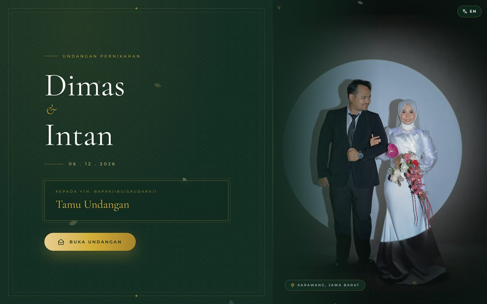
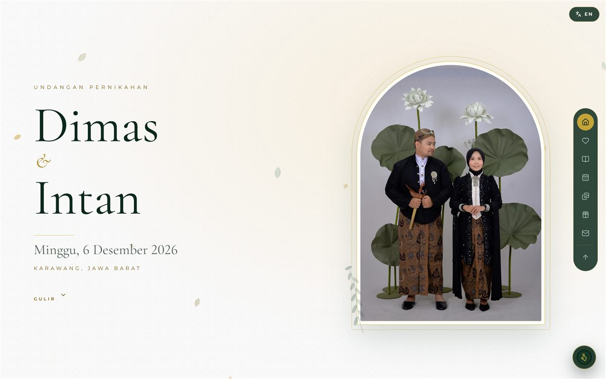
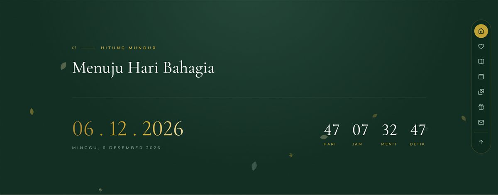
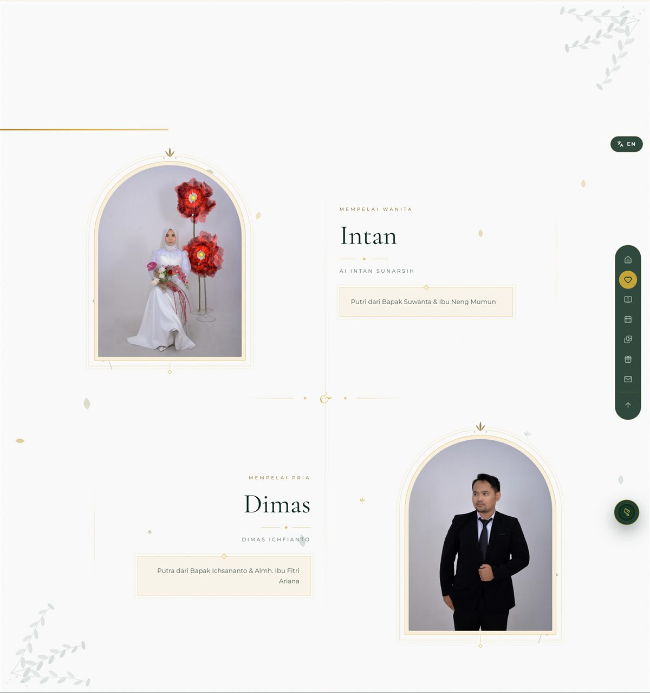
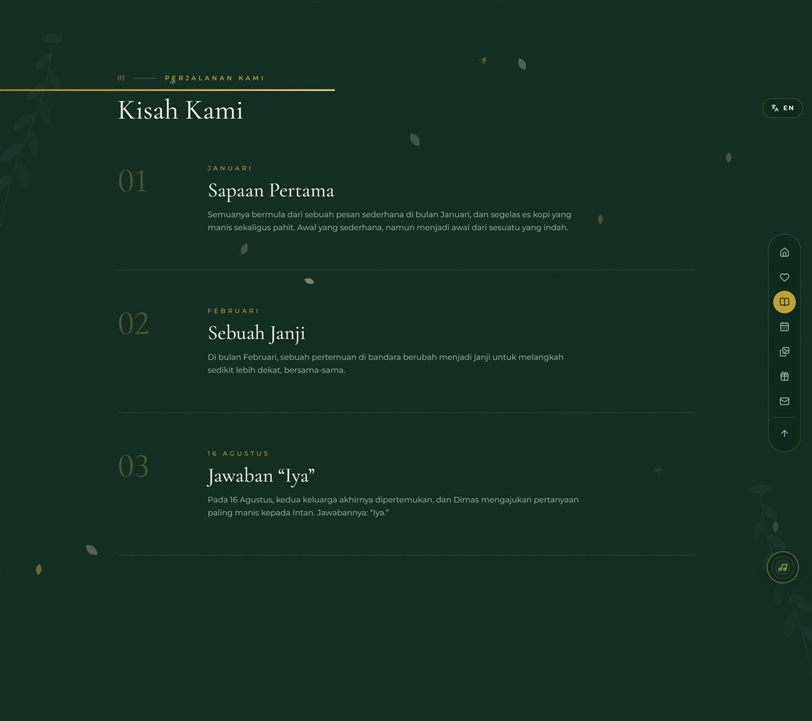
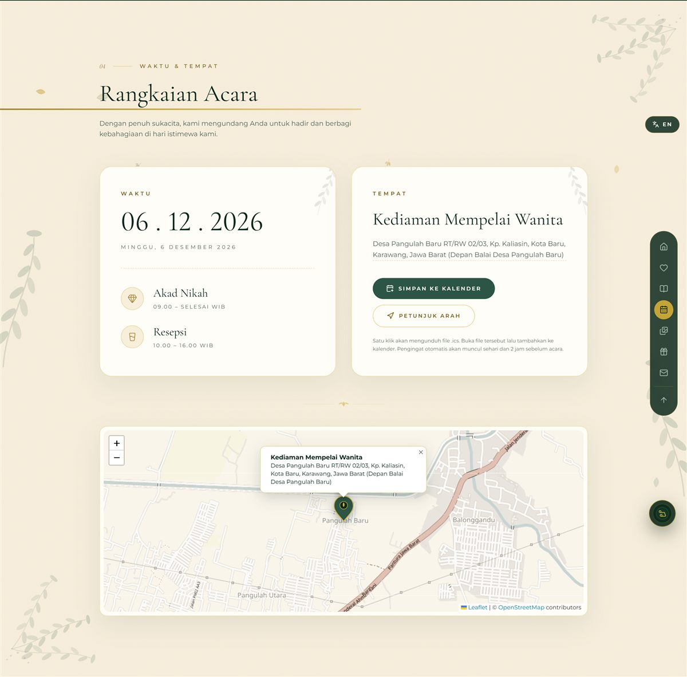
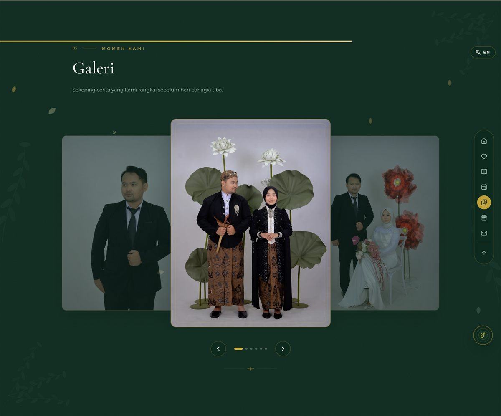
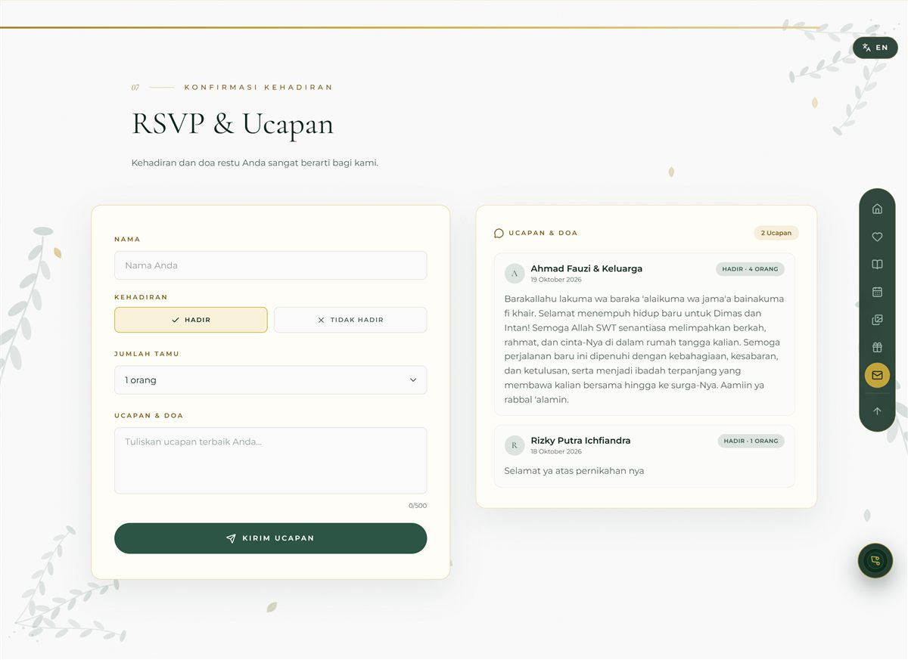
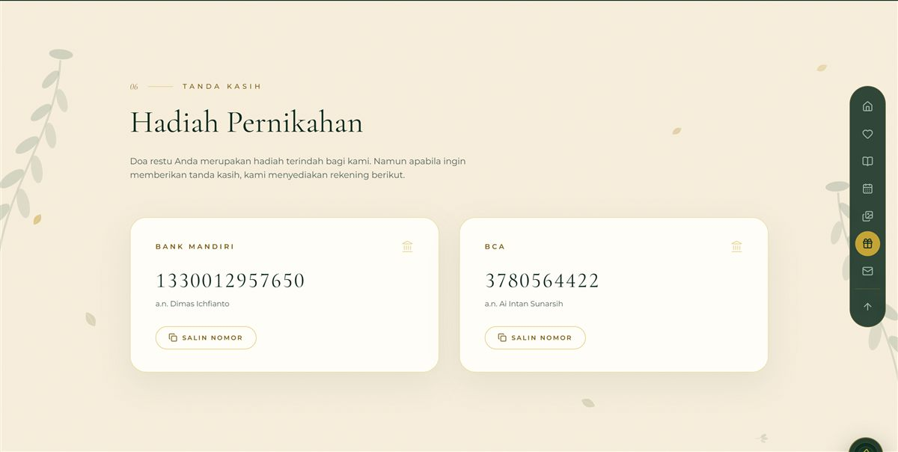

<div align="center">

# WebNikahV2

**Undangan pernikahan digital dwibahasa untuk Dimas & Intan.** Tema *Botanical Luxury* — emerald, emas, dan ornamen botani: hitung mundur, galeri, peta lokasi, RSVP realtime, dan pemutar musik.

[](https://dimas-intan.vercel.app)




</div>

---

## About

Undangan satu halaman yang dibagikan lewat WhatsApp dengan link personal per tamu (`/nama-tamu`), sehingga nama tamu langsung muncul di layar pembuka. Dibuat untuk dipakai sungguhan: 205 tamu, dua bahasa (Indonesia & English), dan ringan dibuka dari ponsel.

**Yang bisa dilakukan tamu:**

- **Buka undangan** dari layar sampul — musik latar mulai dari gestur ketukan, jadi tidak diblokir kebijakan autoplay iOS/WhatsApp.
- **Ganti bahasa** ID ⇄ EN kapan saja, termasuk teks sampul, tanggal panjang, dan pesan WhatsApp.
- **Hitung mundur** menuju hari H, plus simpan acara ke kalender lewat berkas `.ics`.
- **Lihat lokasi** di peta OpenStreetMap, dengan tombol buka Google Maps.
- **Kirim RSVP & ucapan** yang tersimpan di Supabase dan langsung tampil di daftar.
- **Salin nomor rekening** untuk hadiah, satu ketukan.

## Screens

<table>
<tr>
<td width="50%">


**Hero** — potret mempelai, tanggal, dan navigasi ke seluruh bagian.

</td>
<td width="50%">


**Save the Date** — pita emerald dengan hitung mundur hari/jam/menit/detik.

</td>
</tr>
<tr>
<td width="50%">


**Mempelai** — potret lengkung, nama lengkap, dan plakat orang tua.

</td>
<td width="50%">


**Love Story** — perjalanan hubungan dalam alur kronologis.

</td>
</tr>
<tr>
<td width="50%">


**Rangkaian Acara** — akad & resepsi, peta lokasi, tombol kalender.

</td>
<td width="50%">


**Galeri** — carousel dengan efek tumpukan, swipe, dan lightbox.

</td>
</tr>
<tr>
<td width="50%">


**RSVP & Ucapan** — konfirmasi kehadiran dan buku tamu realtime.

</td>
<td width="50%">


**Hadiah** — kartu rekening Mandiri & BCA dengan tombol salin.

</td>
</tr>
</table>

## Built with

| Technology | What it does here |
| --- | --- |
| [React](https://react.dev) 19 + [TypeScript](https://www.typescriptlang.org) 5 | Kerangka UI dengan tipe ketat (`tsc --noEmit` jalan sebelum setiap build). |
| [Vite](https://vite.dev) 6 | Build tool, dev server, dan code splitting per halaman. |
| [Tailwind CSS](https://tailwindcss.com) 4 | Styling utility, design token tema *Botanical Luxury* didefinisikan di `@theme`. |
| [Framer Motion](https://motion.dev) 12 | Transisi masuk antar bagian, carousel galeri, dan kartu pemutar musik. |
| [React Router](https://reactrouter.com) 7 | Rute link tamu `/nama-tamu` dan halaman generator `/buat-link`. |
| [Supabase](https://supabase.com) | Penyimpanan RSVP & ucapan (Postgres + Row Level Security). |
| [Leaflet](https://leafletjs.com) + OpenStreetMap | Peta lokasi tanpa API key, dimuat terpisah agar bundel utama ringan. |
| [SheetJS](https://sheetjs.com) | Impor/ekspor Excel di generator link tamu. |
| [Fontsource](https://fontsource.org) | Cormorant Garamond, Montserrat, Amiri — di-*self-host*, tanpa panggilan ke Google. |
| [Vercel](https://vercel.com) | Hosting SPA dengan rewrite dan cache header aset. |

## Getting started

### Prerequisites

- [Bun](https://bun.sh) 1.1+ (atau Node.js 20+ dengan `npm`)
- Proyek [Supabase](https://supabase.com) gratis — hanya kalau mau fitur RSVP aktif

### 1. Install

```bash
git clone https://github.com/RizkyPutraIchfiandra/WebNikahV2.git
cd WebNikahV2
bun install
```

### 2. Konfigurasi

```bash
cp .env.example .env
```

Isi dengan kredensial Supabase:

```env
VITE_SUPABASE_URL=https://xxxx.supabase.co
VITE_SUPABASE_ANON_KEY=kunci-publishable-anda
```

Jalankan SQL penyiapan tabel di [`docs/SUPABASE-SETUP.md`](docs/SUPABASE-SETUP.md). Tanpa langkah ini situs tetap jalan — RSVP otomatis beralih ke mode lokal.

Data acara (nama, tanggal, lokasi, rekening) ada di satu berkas: [`src/data/weddingConfig.ts`](src/data/weddingConfig.ts).

### 3. Run

```bash
bun run dev
```

### 4. Build

```bash
bun run build
bun run preview   # pratinjau hasil build
```

## Link tamu

Satu link personal per tamu — nama otomatis muncul di sampul undangan.

```
https://dimas-intan.vercel.app/suparmini
https://dimas-intan.vercel.app/bu-ati
```

Buka `/buat-link` untuk membuat link massal: unggah berkas Excel berisi daftar tamu, kolom **Link Undangan** terisi otomatis, lalu berkas hasilnya diunduh kembali.

## Project structure

```
.
├── docs/
│   ├── screens/                Screenshot untuk README
│   ├── DEPLOY.md               Panduan deploy
│   └── SUPABASE-SETUP.md       SQL tabel + Row Level Security
├── scripts/
│   └── process-assets.mjs      Kompres foto ke WebP
├── src/
│   ├── components/
│   │   ├── common/             Reveal, SectionTitle, Toast, Preloader, LanguageToggle
│   │   ├── opening/            Layar sampul + tombol "Buka Undangan"
│   │   ├── hero/               Hero potret mempelai
│   │   ├── countdown/          Pita Save the Date + hitung mundur
│   │   ├── couple/             Profil kedua mempelai
│   │   ├── story/              Love Story kronologis
│   │   ├── event/              Rangkaian acara + peta Leaflet
│   │   ├── gallery/            Carousel + lightbox
│   │   ├── rsvp/               Formulir RSVP & buku tamu
│   │   ├── gift/               Kartu rekening + tombol salin
│   │   ├── music/              Pemutar musik gaya kartu
│   │   ├── ornaments/          Ornamen botani SVG + daun berjatuhan
│   │   ├── quote/              Kutipan ayat
│   │   └── nav/                Navigasi atas & bilah bawah
│   ├── data/weddingConfig.ts   Sumber tunggal data acara
│   ├── hooks/                  useCountdown, useReveal, dll
│   ├── lib/
│   │   ├── i18n.tsx            Kamus & context dwibahasa ID/EN
│   │   ├── guestbook.ts        Klien Supabase + fallback lokal
│   │   ├── guestLink.ts        Slug tamu ⇄ nama
│   │   ├── music.ts            Pemutaran musik + fade volume
│   │   ├── ics.ts              Berkas kalender .ics
│   │   └── clipboard.ts        Salin lintas peramban
│   ├── pages/
│   │   ├── InvitationPage.tsx  Halaman undangan
│   │   └── GuestLinkPage.tsx   Generator link tamu
│   └── styles.css              Design token tema + animasi
└── vercel.json                 Rewrite SPA + cache header
```

## Scripts

| Command | What it does |
| --- | --- |
| `bun run dev` | Jalankan dev server |
| `bun run build` | Cek tipe lalu build produksi |
| `bun run preview` | Pratinjau hasil build |
| `bun run assets` | Kompres foto sumber ke WebP |

## Notes

- **Musik** dimulai dari gestur ketukan tombol "Buka Undangan", bukan dari efek susulan — supaya tidak diblokir kebijakan autoplay iOS Safari dan peramban dalam aplikasi WhatsApp. Pada mode hemat daya iPhone, autoplay tetap diblokir sistem; tamu cukup menekan tombol piringan sekali.
- **Angka** dipaksa memakai *lining figures* agar tinggi semua digit rata, karena Cormorant Garamond defaultnya memakai angka gaya lama yang naik-turun.
- **RSVP** memakai kunci publishable Supabase di sisi klien; penulisan dibatasi lewat Row Level Security, bukan dengan menyembunyikan kunci.
- **Peta** memakai ubin OpenStreetMap standar, jadi tidak perlu API key maupun kuota.

## License

Dibuat untuk acara pribadi Dimas & Intan. Silakan jadikan referensi; ganti data di `src/data/weddingConfig.ts` dan foto di `src/assets` kalau mau dipakai ulang.
